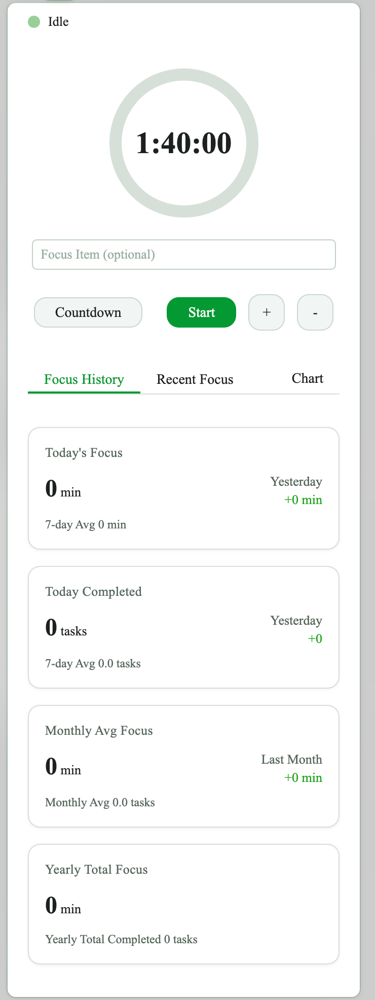
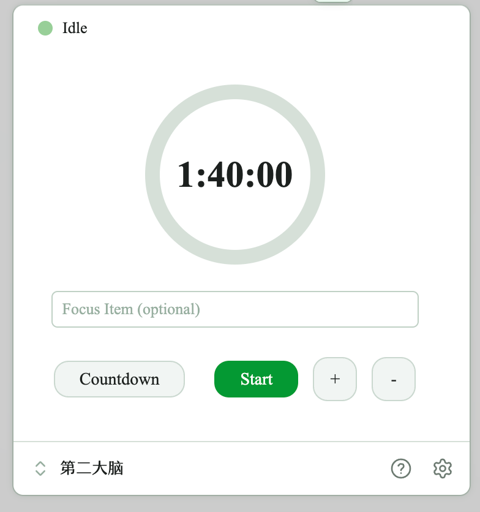
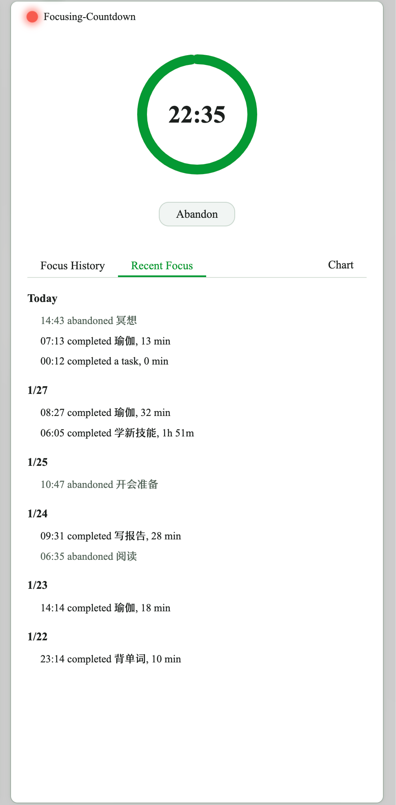
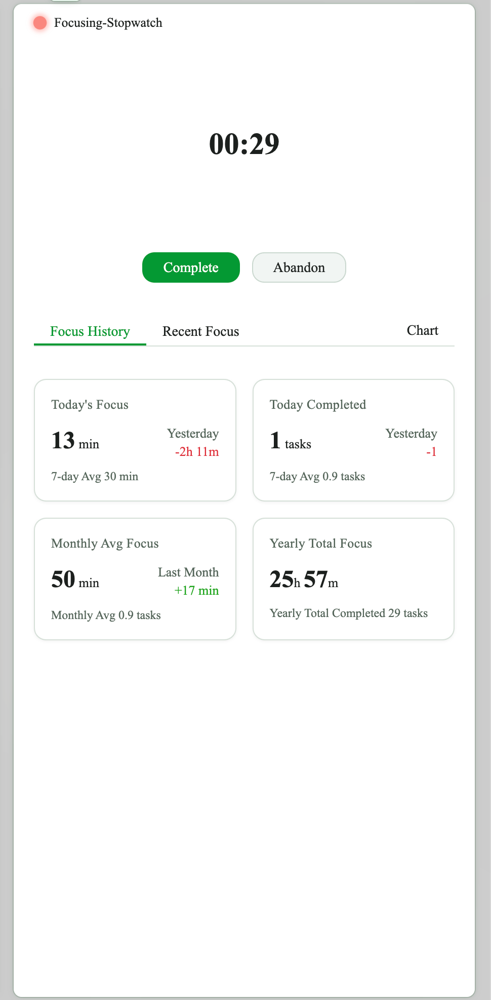
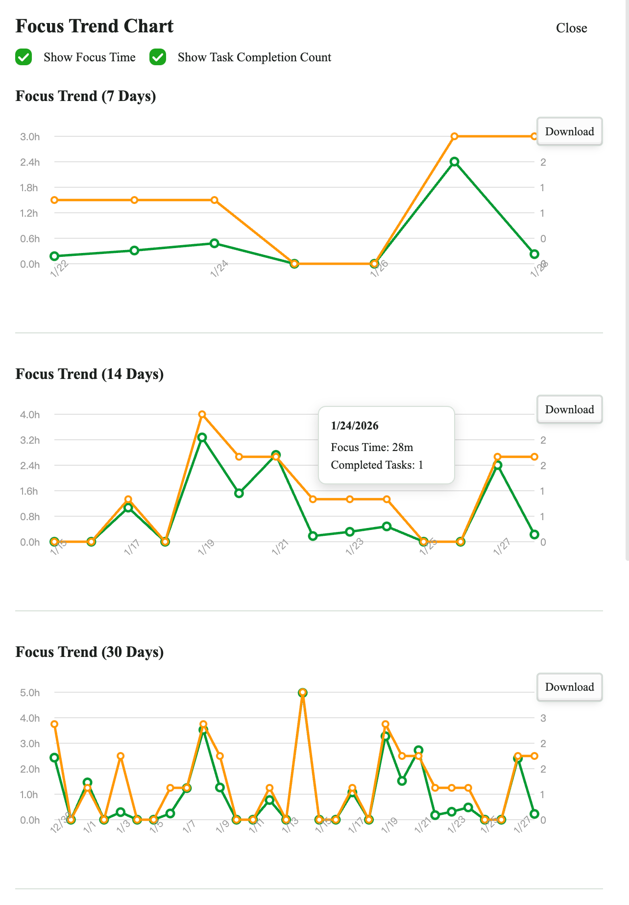
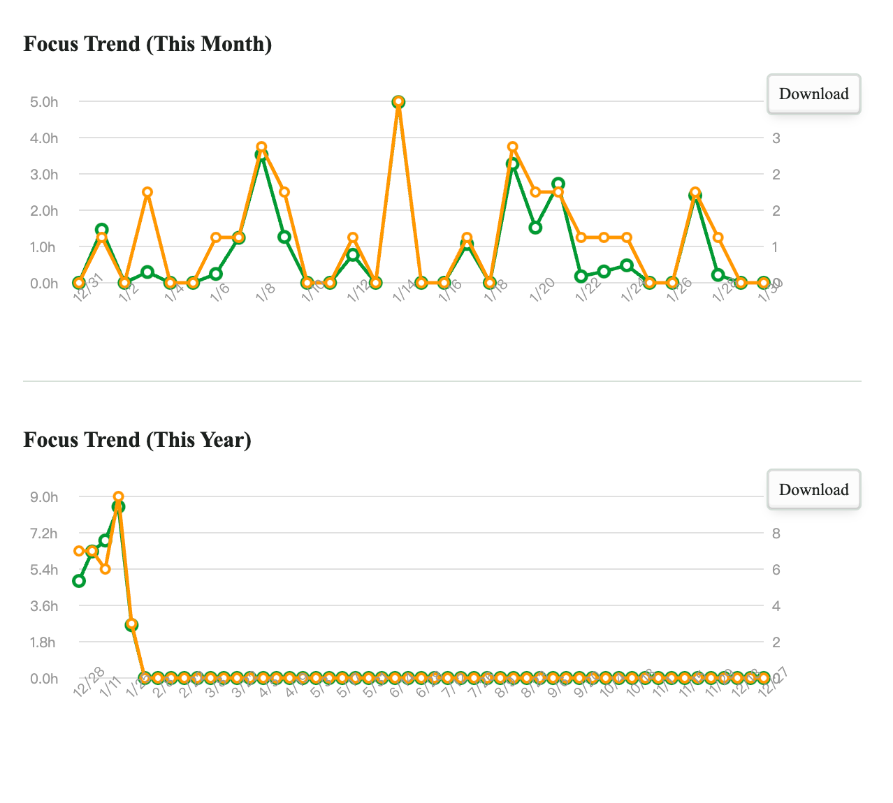
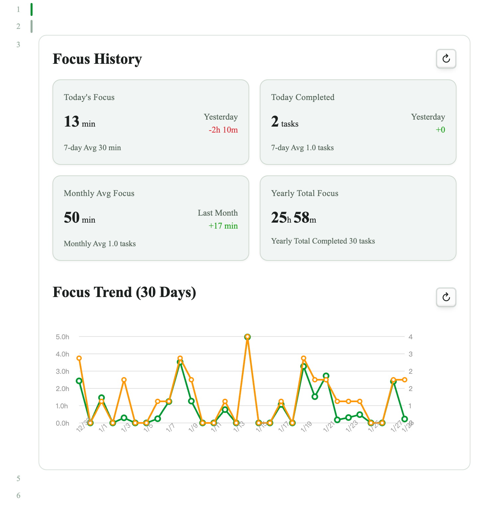
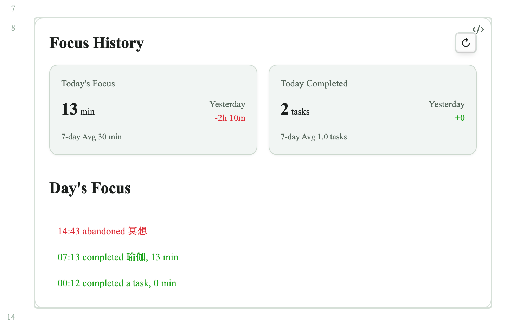
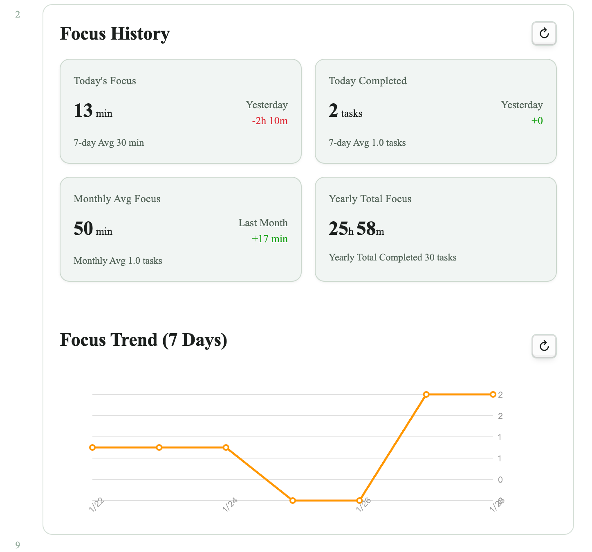
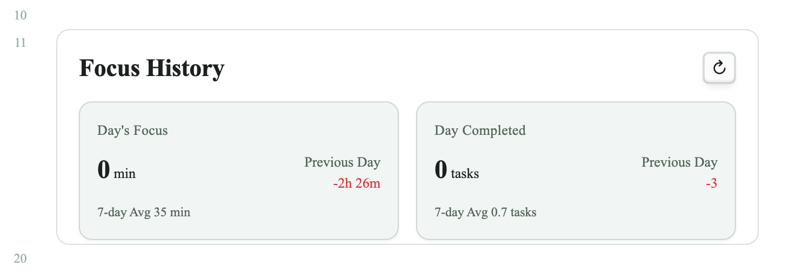

# Focus Timer Plugin - User Guide

> **A note to our users**: Thank you for your support and enthusiasm for Focus Timer! The plugin is still under active development, and some features may be unstable or subject to change. We appreciate your understanding and patience. Feedback and suggestions are welcome via the link below.
> **Help**: https://tianyezhou.com/focus-timer
> **Author**: Tianye Zhou (https://tianyezhou.com), S-Qin(https://github.com/s-qin)

A local focus timer plugin designed for Obsidian, with support for statistical analysis, card view, and embedding data display in notes.

## Quick Start

**Open the timer**: Click the left sidebar icon / bottom status bar / command palette `Open Focus Timer View`

**Start focusing**:
1. Enter a task name (optional, up to 100 ASCII characters or 50 non-ASCII characters such as Chinese)
2. Choose mode: **Countdown** (default 25 minutes) or **Stopwatch**
3. Use +/- buttons to adjust or click the time to set focus duration
4. Click "Start" or press Enter (if keyboard shortcuts are enabled)

**Pause and resume**: Click "Pause" / "Resume" in either timer mode. Paused time is excluded from focus duration; countdown remaining time stays fixed. Paused sessions stay paused after reloading or restarting Obsidian. Complete and Abandon remain available while paused, subject to the existing early-completion setting.

**End a session**:
- **Complete**: Mark as completed and save the record
- **Abandon**: Mark as abandoned and save the record
- When countdown ends, you can start a break period

The panel adapts automatically when the window is narrow or compact:





## Timer Modes

| Mode | Description | Features |
|------|-------------|----------|
| **Countdown** | Count down from a set duration | Can auto-switch to stopwatch / start break period |
| **Stopwatch** | Count up from zero | No preset duration, can pause/resume |

**Countdown**



**Stopwatch**



## Commands

Access via command palette (`Cmd/Ctrl + P`):

- `Start Focus (25m/50m)` - Quick start the timer
- `Stop Focus (Complete)` - Complete current session
- `Pause` / `Resume` - Pause or resume the active focus session; bind shortcuts in Settings → Hotkeys
- `Abandon Focus` - Abandon current session
- `Open Focus Timer View` - Open timer panel
- `Start Quick Timer 1/2/3` - Start preset quick timer 1/2/3

## Statistics and Views

**Focus history**: Card-style layout to view all sessions, filterable by date  
Use the trash icon beside a record to delete it after confirmation. Cancel keeps the record. A successful deletion immediately updates open history/statistics Views, charts, and embedded `focus` blocks; other records and settings are preserved.

**Statistics**: Today's focus duration / completed task count / 7-day average / monthly average / yearly total  
**Charts**: Visualize focus data (7/14/30 days, this month, this year), supports both duration and task count metrics





## Embed in Notes

Use code blocks to embed focus timer data and charts in notes.

### Basic Syntax

````markdown
```focus
```
````

Displays today's focus statistics and the default statistics chart.



````markdown
```focus
date: today
```
````

Displays today's focus statistics and today's focus items list.



Example with chart parameters and custom height:



### Configuration Parameters

| Parameter | Description | Optional Values |
|-----------|-------------|-----------------|
| `date` | Specify date | `today`, `yesterday`, `2026-01-20` (specific date) |
| `chart` | Chart display range (when no date parameter) | `7`, `14`, `30`, `month`, `year`, `none` |
| `chart` | Chart display range + metric (when no date parameter) | `30 time`, `30 task` (first parameter selects from the options above, second parameter chooses between time and task; if omitted, both focus time and completed task count are shown) |
| `record` | Hide records (applies with or without date parameter) | `none` (default: shown when not specified) |
| `items` | Hide focus items list (when date parameter is used) | `none` (default: shown when not specified) |
| `height` | Custom height in pixels (applies with or without date parameter) | `300`, `500` ... |

### Examples

````markdown
```focus
chart: 7 task
height: 500
```
````

Displays today's focus statistics and 7-day completed task count chart, with display box height limited to 500px.

````markdown
```focus
date: 2026-01-01
items: none
height: 400
```
````

Displays that day's statistics and limits the display box height to 400px.



## Tips

- **Task suggestions**: The plugin remembers recent tasks and suggests them when typing
- **Quick access**: Use sidebar icon, status bar, or keyboard shortcuts
- **Quick timers**: Set commonly used timers as quick timer 1/2/3
- **Pomodoro**: Enable auto-break feature
- **Embed anywhere**: Add focus code blocks in journals, project pages, or review documents


---

*Note: This plugin supports desktop only and requires Obsidian 1.4.5 or higher.*
